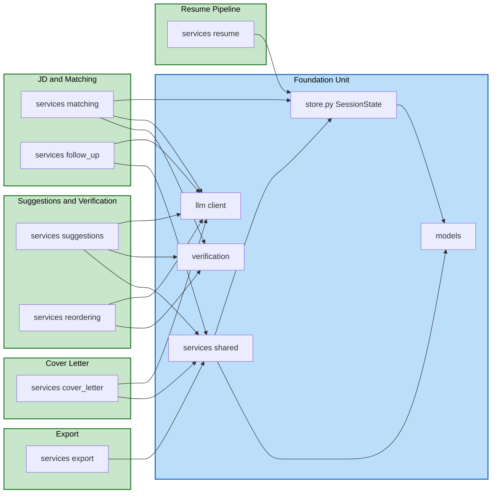

# Component Dependencies: Storywell

**Stage**: INCEPTION — Application Design
**Date**: 2026-11-22

---

## Coupling Rule (Q3)

Feature slices **never import or call each other's `services/*.py` modules directly.** The
only two ways a slice may depend on something outside its own module are:

1. **The shared session object** (`SessionState`, from the Foundation unit) — every slice
   reads and writes fields on it; this is the normal way slices "communicate" without knowing
   about each other.
2. **Foundation-owned shared functions** (`services/shared.py`, `verification/*`) — anything
   more than one slice needs is pulled into the Foundation unit rather than one slice
   depending on another's module.

This directly resolves the cross-slice dependency `requirements.md` §11 flagged as needing an
explicit owner: **FR-330's confirmed-fact creation now lives in `services/shared.py`, owned by
the Foundation unit — not in either the JD & Matching or Suggestions & Verification slice.**
Both slices' API layers call the same Foundation function; neither slice imports the other.

---

## Dependency Matrix

| Component | Depends on | Depended on by |
|---|---|---|
| `app/models/` | — (leaf) | Everything |
| `app/store.py` | `app/models/` | Every API route handler; every service that reads/writes session state |
| `app/llm/client.py` | — (leaf, only `anthropic` import) | `matching.py`, `follow_up.py`, `suggestions.py`, `reordering.py`, `cover_letter.py` |
| `app/verification/suggestions.py` | — (pure, leaf) | `services/suggestions.py` |
| `app/verification/reordering.py` | — (pure, leaf) | `services/reordering.py` |
| `app/verification/matching.py` | — (pure, leaf) | `services/matching.py` |
| `app/services/shared.py` | `app/store.py`, `app/models/` | `services/follow_up.py`, `services/suggestions.py`, `services/cover_letter.py`, `services/export.py` |
| `services/resume.py` | `app/store.py`, `app/models/` | `api/resume.py` |
| `services/matching.py` | `app/store.py`, `app/llm/client.py`, `verification/matching.py` | `api/requirements.py` |
| `services/follow_up.py` | `app/store.py`, `app/llm/client.py`, `services/shared.py` | `api/facts.py` |
| `services/suggestions.py` | `app/store.py`, `app/llm/client.py`, `verification/suggestions.py`, `services/shared.py` | `api/suggestions.py`, `api/facts.py` (FR-330, via the Foundation's shared fact creation) |
| `services/reordering.py` | `app/store.py`, `app/llm/client.py`, `verification/reordering.py` | `api/reordering.py` |
| `services/cover_letter.py` | `app/store.py`, `app/llm/client.py`, `services/shared.py` | `api/cover_letter.py` |
| `services/export.py` | `app/store.py`, `services/shared.py` | `api/export.py` |

No cell in the "Depends on" column names another feature slice's `services/*.py` module — the
coupling rule holds throughout.

---

## Communication Patterns

- **Frontend ↔ Backend**: typed `fetch` calls (`frontend/src/api/client.ts`) against the
  `/api` routes in `technical-environment.md` §5; no other communication channel.
- **Backend intra-slice**: route handler → one service function → (optionally) verification
  and/or LLM client → back to the handler. See `services.md`'s orchestration pattern.
- **Backend cross-slice**: only via `SessionState` fields or `services/shared.py` /
  `verification/*` — never direct module-to-module calls between slices.
- **Staleness propagation**: Resume Pipeline's and JD & Matching's edit endpoints call
  `SessionState.mark_dependents_stale()`; every slice's own regeneration function calls
  `SessionState.clear_stale()` for its own flag; Export's route handler checks
  `SessionState.is_export_blocked()` before proceeding (FR-904).

---

## Data Flow Diagram

### Mermaid Diagram



### Text Alternative

```
Foundation Unit provides: models, store.py (SessionState), llm/client.py, verification/*,
services/shared.py

Resume Pipeline:
  services/resume.py -> store.py

JD & Matching:
  services/matching.py -> store.py, llm/client.py, verification/matching.py
  services/follow_up.py -> llm/client.py, services/shared.py

Suggestions & Verification:
  services/suggestions.py -> llm/client.py, verification/suggestions.py, services/shared.py
  services/reordering.py -> llm/client.py, verification/reordering.py

Cover Letter:
  services/cover_letter.py -> llm/client.py, services/shared.py

Export:
  services/export.py -> services/shared.py

services/shared.py -> store.py -> models (all Foundation-internal)

No arrow points from one feature slice's services module to another feature slice's
services module.
```

---

## Validation Against `requirements.md` §11

- The one flagged cross-slice dependency (FR-330) has an explicit, named resolution:
  `services/shared.py::create_confirmed_fact()`, in the Foundation unit.
- No new cross-slice dependencies were introduced by this design — every "shared" need
  identified during Application Design (confirmed facts, final resume content, style context)
  was resolved the same way, by moving it into the Foundation unit rather than creating a
  slice-to-slice edge.
