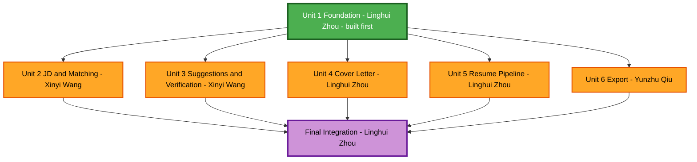

# Unit of Work Dependencies: Storywell

**Stage**: INCEPTION — Units Generation
**Date**: 2026-11-22
**Basis**: `application-design/component-dependency.md` (component-level matrix), aggregated
to the 6 units of work.

---

## Dependency Matrix

| Unit | Owner | Depends on | Depended on by |
|---|---|---|---|
| 1. Foundation | Linghui Zhou | — (built first) | All 5 feature units |
| 2. JD & Matching | Xinyi Wang | Foundation only | Unit 3 (shares the `facts` endpoint, FR-330, via Foundation's `services/shared.py` — not a direct Unit 2→3 code dependency) |
| 3. Suggestions & Verification | Xinyi Wang | Foundation only | — |
| 4. Cover Letter | Linghui Zhou | Foundation only | — |
| 5. Resume Pipeline | Linghui Zhou | Foundation only | — |
| 6. Export | Yunzhu Qiu | Foundation only | — |

**No feature unit depends on another feature unit's code.** Every "Depends on" cell names only
Foundation, confirming the coupling rule from Application Design (Q3) holds at the unit level,
not just the component level. The one apparent cross-unit relationship — Units 2 and 3 both
using the `POST /api/sessions/{sid}/facts` endpoint — is resolved through Foundation's
`services/shared.py::create_confirmed_fact()`, not through one unit calling the other.

---

## Build Sequencing

1. **Foundation's frozen interfaces** committed first (within the first few days of
   Construction, per Question 2 of `unit-of-work-plan.md`).
2. **Units 2–6 build in parallel**, each against the frozen interfaces with `FakeLLMClient`,
   independent of each other and of Foundation's real implementation progress.
3. **Foundation's real implementation** completes in parallel with step 2.
4. **Each unit rebases** onto Foundation's real implementation as it lands.
5. **Final integration** (Linghui Zhou) once all units have rebased.

No unit in step 2 blocks another unit in step 2 — this is what makes genuine 3-developer
parallelism possible within the ~3-week window from `execution-plan.md`.

---

## Dependency Diagram

### Mermaid Diagram



### Text Alternative

```
Unit 1 (Foundation, Linghui Zhou) is built first.
  -> Unit 2 (JD & Matching, Xinyi Wang) depends only on Unit 1
  -> Unit 3 (Suggestions & Verification, Xinyi Wang) depends only on Unit 1
  -> Unit 4 (Cover Letter, Linghui Zhou) depends only on Unit 1
  -> Unit 5 (Resume Pipeline, Linghui Zhou) depends only on Unit 1
  -> Unit 6 (Export, Yunzhu Qiu) depends only on Unit 1

Units 2-6 run in parallel (no dependencies on each other).
All of Units 2-6 feed into Final Integration (Linghui Zhou).
```

---

## Validation

- Every unit's dependency is satisfied by the build sequencing above (Foundation's frozen
  interfaces land before any feature unit needs them).
- No circular dependencies.
- The FR-330 cross-slice dependency has a named, non-circular resolution (shared Foundation
  function, not a Unit 2 ↔ Unit 3 edge).
