# Execution Plan: Storywell

**Stage**: INCEPTION — Workflow Planning
**Date**: 2026-11-22
**Basis**: `requirements.md` (approved, incl. the FR-222/FR-223 change of 2026-11-22),
`stories.md` (26 stories, approved), `personas.md` (3 personas, approved)

---

## Detailed Analysis Summary

### Transformation Scope
Not applicable — **greenfield** project (per Workspace Detection; no existing codebase).

### Change Impact Assessment
- **User-facing changes**: Yes — the entire product is new and user-facing; all 26 stories in
  `stories.md` describe direct user interaction across the 8-step wizard.
- **Structural changes**: Yes — new system architecture being established from scratch:
  FastAPI backend, React frontend, an LLM boundary module, and a deterministic verification
  layer (`requirements.md` NFR-301, NFR-603).
- **Data model changes**: Yes — the core Pydantic models from `technical-environment.md` §5,
  as refined by `requirements.md` §7 (the `RequirementMatch.evidence_ids` invariants,
  including the `found`-requires-evidence rule added 2026-11-22, and the new
  `ReorderSuggestion` type).
- **API changes**: Yes — new endpoints across every unit of work (session creation, resume
  upload/parsing, JD/matching, follow-up questions and confirmed facts, suggestions and
  verification, reordering, cover letter, export).
- **NFR impact**: Yes — extensive NFRs across privacy, security, reliability/LLM handling,
  performance/cost, testability, maintainability, and prohibited technologies
  (`requirements.md` §6).

### Component Relationships
Not a brownfield component graph, but `requirements.md` §11 already defines the unit
relationships that Units Generation will formalize:
- **Foundation unit** (built first): Pydantic data models, in-memory session store, LLM client
  wrapper, API contract, wizard shell. Owned by Linghui Zhou, who also owns final integration.
- **Five vertical feature slices** (built in parallel once the foundation unit lands): Resume
  Pipeline, JD & Matching, Suggestions & Verification, Cover Letter, Export. Slice ownership
  beyond the foundation unit is deferred to Units Generation (`requirements.md` A-5).
- **One flagged cross-slice dependency**: the `POST /api/sessions/{sid}/facts` endpoint
  (FR-330) is owned by the JD/Matching slice but is invoked from the Suggestions &
  Verification screen (`requirements.md` §11 note; `stories.md` US-SUGGEST-05). Units
  Generation must assign this an explicit owner in the dependency map.

### Risk Assessment
- **Risk Level**: **Medium**. Not Low — the truthfulness rule (PR-1) is a correctness-critical
  constraint cutting across nearly every feature, three developers are coordinating on
  vertical slices built in parallel, and there is one explicit cross-slice dependency
  (FR-330) that needs careful sequencing. Not High/Critical — the system is local-only, has no
  production deployment, no persistent data store, and (being greenfield) carries no
  regression risk against an existing system.
- **Rollback Complexity**: Easy — greenfield, no production system to roll back; version
  control alone is the safety net.
- **Testing Complexity**: Moderate — `FakeLLMClient`-based unit/API tests, an 80% coverage
  floor on `app/services` and `app/verification`, Hypothesis property-based tests (Partial
  mode: PBT-02/03/07/08/09), and a manual truthfulness evaluation set (NFR-505) all add real
  but well-scoped testing surface.

---

## Workflow Visualization

### Mermaid Diagram

```mermaid
flowchart TD
    Start(["User Request"])

    subgraph INCEPTION["INCEPTION PHASE"]
        WD["Workspace Detection<br/><b>COMPLETED</b>"]
        RA["Requirements Analysis<br/><b>COMPLETED</b>"]
        US["User Stories<br/><b>COMPLETED</b>"]
        WP["Workflow Planning<br/><b>IN PROGRESS</b>"]
        AD["Application Design<br/><b>EXECUTE</b>"]
        UG["Units Generation<br/><b>EXECUTE</b>"]
    end

    subgraph CONSTRUCTION["CONSTRUCTION PHASE (per unit)"]
        FD["Functional Design<br/><b>EXECUTE</b>"]
        NFRA["NFR Requirements<br/><b>EXECUTE</b>"]
        NFRD["NFR Design<br/><b>EXECUTE</b>"]
        ID["Infrastructure Design<br/><b>SKIP</b>"]
        CG["Code Generation<br/><b>EXECUTE</b>"]
        BT["Build and Test<br/><b>EXECUTE</b>"]
    end

    subgraph OPERATIONS["OPERATIONS PHASE"]
        OPS["Operations<br/><b>PLACEHOLDER</b>"]
    end

    Start --> WD
    WD --> RA
    RA --> US
    US --> WP
    WP --> AD
    AD --> UG
    UG --> FD
    FD --> NFRA
    NFRA --> NFRD
    NFRD --> ID
    ID --> CG
    CG --> BT
    BT --> End(["Complete"])
    BT --> OPS

    style WD fill:#4CAF50,stroke:#1B5E20,stroke-width:3px,color:#fff
    style RA fill:#4CAF50,stroke:#1B5E20,stroke-width:3px,color:#fff
    style US fill:#4CAF50,stroke:#1B5E20,stroke-width:3px,color:#fff
    style WP fill:#FFA726,stroke:#E65100,stroke-width:3px,color:#000
    style AD fill:#FFA726,stroke:#E65100,stroke-width:3px,stroke-dasharray: 5 5,color:#000
    style UG fill:#FFA726,stroke:#E65100,stroke-width:3px,stroke-dasharray: 5 5,color:#000
    style FD fill:#FFA726,stroke:#E65100,stroke-width:3px,stroke-dasharray: 5 5,color:#000
    style NFRA fill:#FFA726,stroke:#E65100,stroke-width:3px,stroke-dasharray: 5 5,color:#000
    style NFRD fill:#FFA726,stroke:#E65100,stroke-width:3px,stroke-dasharray: 5 5,color:#000
    style ID fill:#BDBDBD,stroke:#424242,stroke-width:2px,stroke-dasharray: 5 5,color:#000
    style CG fill:#4CAF50,stroke:#1B5E20,stroke-width:3px,color:#fff
    style BT fill:#4CAF50,stroke:#1B5E20,stroke-width:3px,color:#fff
    style OPS fill:#FFF59D,stroke:#F57F17,stroke-width:2px,stroke-dasharray: 5 5,color:#000
    style Start fill:#CE93D8,stroke:#6A1B9A,stroke-width:3px,color:#000
    style End fill:#CE93D8,stroke:#6A1B9A,stroke-width:3px,color:#000

    linkStyle default stroke:#333,stroke-width:2px
```



### Text Alternative

```
INCEPTION PHASE
- Workspace Detection — COMPLETED
- Requirements Analysis — COMPLETED
- User Stories — COMPLETED
- Workflow Planning — IN PROGRESS (this document)
- Application Design — EXECUTE
- Units Generation — EXECUTE

CONSTRUCTION PHASE (repeats per unit of work, once units are defined)
- Functional Design — EXECUTE
- NFR Requirements — EXECUTE
- NFR Design — EXECUTE
- Infrastructure Design — SKIP
- Code Generation — EXECUTE (always)
- Build and Test — EXECUTE (always, after all units complete)

OPERATIONS PHASE
- Operations — PLACEHOLDER (future expansion)
```

---

## Milestone Boundary

**This workflow run stops after Units Generation is approved.** Per the course schedule:

- The **mid-semester milestone** covers the INCEPTION phase only, through Units Generation.
  Once Units Generation is generated and the user explicitly approves it, this workflow
  **does not automatically continue** into the CONSTRUCTION phase (Functional Design, NFR
  Requirements, NFR Design, Code Generation, Build and Test).
- **Construction and the final project deliverable happen later**, in a separate work
  session, started deliberately by the user — not chained automatically off of Units
  Generation's approval.
- The "Phases to Execute" list below still documents the full plan (including Construction)
  for completeness and for the final project to resume from, but the stages under
  CONSTRUCTION PHASE are **not entered in this session**.

---

## Phases to Execute

### 🔵 INCEPTION PHASE
- [x] Workspace Detection (COMPLETED)
- [ ] Reverse Engineering (SKIPPED — greenfield, no existing codebase)
- [x] Requirements Analysis (COMPLETED)
- [x] User Stories (COMPLETED)
- [x] Workflow Planning (IN PROGRESS — this document)
- [ ] Application Design — **EXECUTE**
  - **Rationale**: `requirements.md` §13 explicitly defers "component boundaries, service
    signatures, endpoint refinement" to this stage. Six new units of work (foundation + 5
    slices) all need their component methods, business rules, and inter-component
    dependencies defined before Units Generation can assign responsibilities concretely.
- [ ] Units Generation — **EXECUTE**
  - **Rationale**: `requirements.md` §11 already calls for a structured breakdown (shared
    foundation unit + five vertical feature slices) and explicitly defers "unit decomposition
    and dependency map" to this stage, including the one flagged cross-slice dependency
    (FR-330).

### 🟢 CONSTRUCTION PHASE
*(Each stage below executes once per unit of work, per the CLAUDE.md Per-Unit Loop, after
Units Generation defines the six units.)*

- [ ] Functional Design — **EXECUTE**
  - **Rationale**: Every unit involves new data models or non-trivial business logic — the
    truthfulness verification rules (`verify_suggestion`, flag types), the JD matching and
    evidence-status logic (including the 2026-11-22 `found`-requires-evidence invariant), the
    follow-up-question rounds, and the reorder permutation check all need detailed design
    before code generation.
- [ ] NFR Requirements — **EXECUTE**
  - **Rationale**: Clear performance (NFR-401 to NFR-403), security (NFR-201 to NFR-210), and
    testability (NFR-501 to NFR-508) requirements exist and need to be mapped onto each unit's
    concrete implementation, even though the technology stack itself is already fixed by
    `technical-environment.md`.
- [ ] NFR Design — **EXECUTE**
  - **Rationale**: Follows directly from NFR Requirements executing; the Security Baseline and
    Property-Based Testing extension patterns (both enabled, per `aidlc-state.md`) need to be
    incorporated into each unit's design.
- [ ] Infrastructure Design — **SKIP**
  - **Rationale**: No cloud resources, deployment architecture, or infrastructure services to
    map — the system binds to `127.0.0.1` only, has no persistent store, and explicitly
    excludes cloud deployment (`requirements.md` NFR-701, out of MVP scope). The local run
    commands are already specified in `technical-environment.md`'s directory layout.
- [ ] Code Generation — **EXECUTE (ALWAYS)**
  - **Rationale**: Implementation planning and code generation needed for every unit.
- [ ] Build and Test — **EXECUTE (ALWAYS)**
  - **Rationale**: Build, unit/integration/performance test instructions needed across all
    units once Code Generation completes for each.

### 🟡 OPERATIONS PHASE
- [ ] Operations — **PLACEHOLDER**
  - **Rationale**: Future deployment and monitoring workflows; not applicable to this
    local-only MVP.

---

## Unit Build Sequence (from `requirements.md` §11)

1. **Foundation unit** (must complete first) — Pydantic data models, in-memory session store,
   LLM client wrapper, API contract, wizard shell. Owner: Linghui Zhou.
2. **Five vertical feature slices** (parallel, after the foundation unit): Resume Pipeline,
   JD & Matching, Suggestions & Verification, Cover Letter, Export. Per-slice ownership
   (beyond the foundation unit) is assigned during Units Generation.
3. **Final integration** (after all slices complete) — owned by Linghui Zhou.

The explicit cross-slice dependency (FR-330, the confirmed-fact-from-suggestions-screen
endpoint) must be resolved to a single named owner during Units Generation before that slice's
Functional Design begins.

**Sizing constraint for Units Generation**: the five feature slices must be sized so that
three developers, each owning one slice end to end, can build theirs in **about three
weeks** (the gap between the Construction start and the final project deadline below). Units
Generation should take this into account when deciding whether any slice needs further
splitting or rebalancing.

---

## Course Deadlines

| Milestone | Scope | Due |
|---|---|---|
| **Mid-semester milestone** | INCEPTION phase, through Units Generation (this workflow run) | **November 24, 2026** |
| **Final project** | CONSTRUCTION phase (per-unit Functional Design → Code Generation) and Build and Test | **December 16, 2026** |

- **Total Stages to Execute in this run**: 2 (Application Design, Units Generation) —
  Construction's per-unit stages (Functional Design / NFR Requirements / NFR Design / Code
  Generation × 6 units, then one shared Build and Test pass) are planned here but execute
  later, in the final project, per the Milestone Boundary above.
- **Available build time after Inception**: about three weeks between Construction starting
  (after the mid-semester milestone) and the December 16, 2026 final project deadline — the
  basis for the slice-sizing constraint above.

## Success Criteria

- **Primary Goal**: Construction proceeds unit by unit — foundation unit first, then the five
  feature slices — producing working code that satisfies all 73 functional requirements and
  26 user stories without violating the truthfulness rule (PR-1).
- **Key Deliverables**: Application design doc (component boundaries + service signatures);
  unit decomposition and dependency map; per-unit functional/NFR designs; generated backend
  and frontend code; passing build/test instructions (unit, integration, and the manual
  truthfulness eval set).
- **Quality Gates**: `ruff`/`mypy`/`eslint`/`tsc --noEmit` clean; ≥ 80% line coverage on
  `app/services` and `app/verification`; every truthfulness rule has at least one test proving
  a violation is caught (NFR-504); the enforced PBT properties (PBT-02/03/07/08/09) pass,
  including the two invariants added during requirements/story review (`not_found` ⟺ empty
  `evidence_ids`, `found` ⟺ non-empty `evidence_ids`, and the reorder exact-permutation check).
